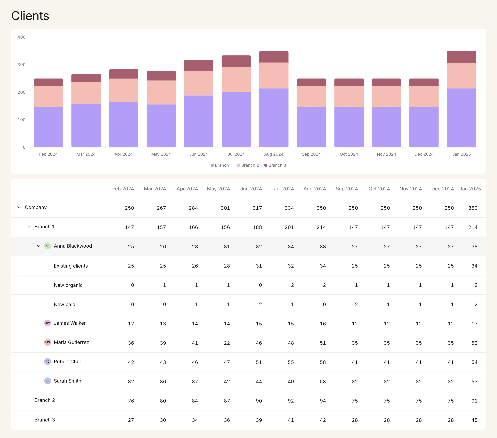

# Nevis clients dashboard

A single-page "Clients" dashboard: a stacked bar chart of the last twelve months and a
hierarchical table that drills from the company down to branches, advisers and acquisition
channels. React 19 + TypeScript on the front, a small Fastify REST API serving the brief's payload
behind it, a shared zod contract in between. Accessible (WAI-ARIA treegrid, keyboard-first),
tested (83 tests), and nothing breaks down to 375px.



## Run it

Prerequisites: **Node 22** (`.nvmrc`; `nvm use`) and npm 10.

```bash
npm install
```

```bash
npm run dev
```

Web on <http://localhost:5173>, API on <http://localhost:3001> (`/api/health`, `/api/clients`);
Vite proxies `/api` to the API.

```bash
npm test
```

```bash
npm run lint
```

```bash
npm run typecheck
```

```bash
npm run build
```

Other scripts: `npm run test:coverage`, `npm run format`, `npm run preview -w apps/web`,
`npm start -w apps/api` (serves `apps/api/dist` after a build; `API_PORT`/`API_HOST` override the
defaults).

**Demo the loading and error states** from the address bar — the dashboard forwards these two
query params to the API, which honours them in development only:

- <http://localhost:5173/?delay=2000> — the API waits 2 s (max 30 s) → spinners in both cards.
- <http://localhost:5173/?fail=1> — the API answers 500 → error card with the server's message.
  **Retry** drops the flag and refetches, so you can watch the recovery.

Troubleshooting: if `npm install` crashes with `Cannot read properties of null (reading 'edgesOut')`
while _adding_ a dependency, that is an npm 10.9 resolver bug on jsdom's optional `canvas` peer;
run the install with `--legacy-peer-deps` once. Installing from the committed lockfile is unaffected.

## What's where

```
apps/web                 Vite + React 19 + TanStack Query + CSS Modules   (port 5173)
  src/app                App, QueryProvider, tokens.css, global.css
  src/shared/ui          Card, Avatar, VisuallyHidden, ChevronIcon, Spinner, ErrorState
  src/shared/lib         formatMonth, cn
  src/features/clients   api/ (fetch + query hook) · model/ (tree, layout — pure, unit-tested)
                         ui/ (ClientsDashboard, StackedBarChart, TreeTable, Legend)
apps/api                 Fastify 5, GET /api/clients + /api/health         (port 3001)
  src/data/clients.json  the brief's payload, byte-for-byte (a test enforces it)
packages/contracts       zod schemas + inferred types of the API response
docs/                    BRIEF.md · PROMPT.md · DEVLOG.md · DECISIONS.md · screenshots/
```

## Design decisions

The long version is the 42-row register in [`docs/DECISIONS.md`](docs/DECISIONS.md); the short one:

- **Monorepo with npm workspaces**, one `npm install`, `npm run dev` starts both apps. No pnpm or
  task runner — nothing to install that a reviewer does not already have.
- **`packages/contracts`** is the boundary. The API validates its payload against the zod schema at
  startup (every node must have one value per month); the web parses every response through it, so
  a malformed payload becomes a readable error instead of `NaN`s in a table.
- **Hand-rolled SVG chart.** `buildStackedLayout(series, months, { height, tickCount })` is a pure
  function returning segment geometry, ticks and the scale; the component only draws. That gives an
  exact match to the design (clipped rounded columns, dashed grid), full control over the a11y
  markup, and turns "how data maps into the chart" into unit tests on numbers.
- **WAI-ARIA treegrid** for the table. A real `<table role="treegrid">`; rows carry
  `aria-level/posinset/setsize` and `aria-expanded` only when they have children; the row itself is
  the focusable, clickable unit (roving `tabIndex`), as in the design's whole-row click target.
  Collapsed children are not in the DOM at all.
- **TanStack Query** for fetching (loading/error/retry/caching the way real teams do it); expanded
  state is a `Set` in a `useReducer` local to the table — it has exactly one consumer.
- **CSS Modules + custom-property tokens.** Every value from the Figma file is a token in
  `tokens.css`; dark mode would be a second token block.
- **Pinned to known-good majors** (TypeScript 5.9, Vite 7, Vitest 4, ESLint 9) rather than the
  registry's newest (TS 7, Vite 8, Vitest 5, ESLint 10) — see DECISIONS #28.

## Assumptions & open questions

### Things we think the brief or the design got wrong

- **The chart legend assumes data that does not exist (Q2).** The design's legend shows acquisition
  channels (Existing clients / New organic / New paid), but only Anna Blackwood has channel data —
  about 10% of the company. Stacking the company by channel would need an "Unattributed" bucket
  covering ~90% of every bar. So the chart **stacks the company by branch** (Branch 1/2/3) with the
  three series colours from the design. `StackedBarChart` is data-agnostic, so switching to channels
  or to "the selected row's children" is a one-line change — first item under "what I'd do next".
- **Children do not add up to their parents (Q3).** Company May 2024 is 301 but the branches sum to
  279; Branch 1 Aug 2024 is 214 but its advisers sum to 216; Anna Blackwood's May–Sep 2024 figures
  differ from her channels by ±1–2. Maria Gutierrez's May 2024 = **22** between 41 and 46 looks like
  a typo — with 44, the company's May total would reconcile exactly. **The payload is the source of
  truth**: values are shown as served and never recomputed. A unit test (`consistency.test.ts`)
  asserts these exact mismatches so the next person sees them. Consequence: the chart's May 2024
  column shows 279 (the branch sum) while the Company row says 301.
- **The Figma mockup disagrees with the payload (Q4):** Branch 1 Jul 2024 = 291 in Figma (201 in
  the data), Robert Chen Aug 2024 = 56 (58), and the "New paid" values are in a different order.
  Payload wins.
- **Branch 2 and Branch 3 have chevrons in the mockup but no employees in the data (Q1).** They
  render as leaves: no chevron, no `aria-expanded`, not interactive, name still indented to align
  with Branch 1. We read the chevrons as a mockup oversight; if a branch should be expandable to an
  empty state on purpose, that is a one-line change in `TreeRow`.

### The rest

- **Avatars (Q5):** the design shows photos; the payload has no avatar field. `Avatar` renders
  initials on a colour derived from the node id. The API was not extended with fake URLs.
- **Months (Q6):** the payload has no dates; "Feb 2024 … Jan 2025" comes from the design only. The
  API returns `months` as ISO `YYYY-MM` next to the tree and asserts every node has one value per
  month. The UI formats them (`en-US` short month — `en-GB` renders "Sept").
- **Y axis (Q7):** computed from the data (nice max = next hundred, 5 ticks); the design's 0–400 is
  what this payload produces.
- **Collapsing a parent keeps its descendants' expanded state (Q8)**, so re-expanding restores the
  previous view.
- **Whole-row click target (Q9)**, per the design and the treegrid pattern. Trade-off: a nested
  button would be more discoverable for screen-reader users who browse by form controls.
- **No hover on leaf rows (Q10)** — hover means "clickable".
- **No row-driven chart (Q11)** — not in the design; see Q2 and "next".
- **The first header cell says "Placeholder" in white in Figma (Q12)** — rendered as a
  visually-hidden "Name" so assistive technology gets a column name.
- Decisions made while building (tooling pins, port variables, retry policy, focus-ring drawing…)
  are rows 28–42 of the register, each with the alternative considered and when to revisit.

## Accessibility

Keyboard, with focus on a row of the table:

| Key              | Action                                                         |
| ---------------- | -------------------------------------------------------------- |
| `Tab`            | enters the grid on the active row (one tab stop for the grid)  |
| `↓` / `↑`        | next / previous visible row                                    |
| `→`              | expand; if already expanded, move to the first child           |
| `←`              | collapse; if already collapsed (or a leaf), move to the parent |
| `Enter`, `Space` | toggle                                                         |
| `Home` / `End`   | first / last visible row                                       |

Pattern: `<table role="treegrid">`; every `<tr role="row">` has `aria-level`, `aria-posinset`,
`aria-setsize`, and `aria-expanded` only when it has children; name cells are `th scope="row"`,
value cells `role="gridcell"`; a 2px focus ring on the active row. The chart is one `role="img"`
with a label, followed by the legend (a real list) and a visually-hidden `<table>` with the same
numbers. Loading is a polite `role="status"`; failure a `role="alert"` with a Retry button.

To try it with VoiceOver: `⌘F5`, then `VO-→` into the table, `VO-Shift-↓` to interact with it and
use the keys above; the chart's hidden table is reached with `VO-→` after the legend.

## Testing

83 tests, Vitest everywhere: `npm test` (or per workspace, `npm test -w apps/web`).

- **contracts** (7): the brief's payload parses unchanged; non-uniform nesting; malformed nodes and
  month/value misalignment are rejected.
- **api** (9, `app.inject()`): response shape against the contract; `clients.json` is byte-for-byte
  the brief's JSON block; `?fail=1`, `?delay`, invalid delays, flags ignored in production, 404.
- **web** (67, RTL + user-event + jsdom): model (`flattenTree`, `buildStackedLayout`, the Q3
  mismatch list), **TreeTable** (click expand/collapse, children removed from the DOM, every key
  above, roving tabindex, ARIA per row, leaves have no `aria-expanded`), **StackedBarChart**
  (12 × 3 segments, exact pixel heights from a fixed layout, fills, ticks, `role="img"`, hidden
  table, legend), **ClientsDashboard** with a mocked `fetch` (loading, success, server error,
  network error, contract mismatch, Retry recovery, dev-flag forwarding).

Line coverage (`npm run test:coverage`): contracts 100%, api 88%, web 99%.

## What I'd do next

1. **Chart breakdown selector / row-driven chart** — stack by the selected row's children (or by
   channel where it exists). `StackedBarChart` already takes any `series`; what is missing is the
   control and the expanded-state lift.
2. **Playwright e2e** for the keyboard map and the 375px layout against a real browser (the
   screenshots in `docs/screenshots/` were produced that way by hand).
3. **Avatars from the API** — `avatarUrl?: string` on adviser nodes, `Avatar` falls back to initials.
4. **Virtualised rows** once a tree has hundreds of visible rows.
5. **Number formatting / i18n** — thousands separators and a locale-aware `formatMonth`.
6. **Column pinning for the current month** next to the sticky name column.
7. **Dark mode** through the token layer (`tokens.css` is the only file with colours).
8. **CI workflow** running lint, typecheck, tests and build on every push.
9. A "figures don't add up" hint in the UI powered by the existing `findMismatches()`.

## Time spent

About **50 minutes of wall-clock** for the build itself, as one autonomous Claude Code session
(Claude Fable 5.1) executing [`docs/PROMPT.md`](docs/PROMPT.md) — one commit per step, elapsed
times per step in [`docs/DEVLOG.md`](docs/DEVLOG.md). The prompt is the product of a prior design
review of the Figma file and the payload (the twelve open questions and their resolutions were
decided there), which took roughly an hour on top. The brief says "use LLMs however you normally
would"; this is how: a human review and decisions up front, an agent for the typing, a paper trail
for both.

## Links

- [`docs/BRIEF.md`](docs/BRIEF.md) — the assignment, verbatim from the PDF (only the title line and source note are ours)
- [`docs/PROMPT.md`](docs/PROMPT.md) — the build prompt with the extracted design spec
- [`docs/DEVLOG.md`](docs/DEVLOG.md) — chronological log, including what went wrong
- [`docs/DECISIONS.md`](docs/DECISIONS.md) — the decision register
- [`docs/screenshots/`](docs/screenshots/) — desktop, expanded, keyboard focus, 375px, loading, error
- [Figma — Web engineer home task](https://www.figma.com/design/aEd0UMLuaQ0wMhxgeWXFxg/Web-engineer-home-task--Copy-?node-id=15-463&p=f&t=TIpdTabo4NvoY8aG-0)
